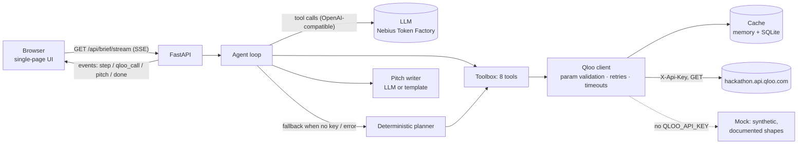

# Opening Act

**A taste-graph booking agent for independent music promoters and small-venue bookers.**

Give it a headliner and a city. An agent walks the [Qloo](https://www.qloo.com) taste graph in a visible, multi-step tool-calling loop and returns a one-page **booking brief**:

- **Openers whose fans already overlap with the headliner's**, biased toward emerging acts, with affinity scores and 12-week momentum
- **Who the crowd is**: age and gender affinity of the headliner's audience
- **Where the crowd lives**: neighborhoods ranked by audience heat, for street teams, posters and geo-targeted ads
- **Venues** whose patrons share the headliner's taste
- **Sponsor and partner brands** the audience over-indexes on
- **Why the opener fits**: shared taste tags, side by side
- A **booking pitch** for the opener's agent (or a sponsor) that cites the Qloo numbers, plus Markdown export and a print view

Swap the opener or change the city and the brief is rebuilt.

> Built for the Qloo Agentic Hackathon. MIT licensed.

---

## The problem

Most live music happens in small rooms. The people booking them (independent promoters, talent buyers at clubs, DIY collectives) pick openers and plan promo from gut feel, Spotify "Fans also like" lists and DMs. The questions that decide whether a night sells are measurement questions:

- Which *smaller* artists share an audience with my headliner, so the opener helps sell tickets and the crowd shows up early?
- Who is that audience, and **which neighborhoods** do they live in, so the flyer and ad budget goes to the right blocks?
- Which venue's crowd matches, and **which local brands** would want to sponsor this exact audience?

Big promoters have data teams for this. Small promoters have none.

## Why this needs Qloo (Without Qloo vs. with Qloo)

| Question | LLM alone | Opening Act + Qloo |
|---|---|---|
| Who should open? | Plausible genre neighbours, often far too big to open, no evidence | Artists ranked by **audience-overlap affinity** with the headliner, capped at the headliner's popularity, re-ranked to favour emerging acts |
| Are they on the way up? | Guesswork, frozen at a training cutoff | `/v2/trending`: 12-week popularity percentile and velocity |
| Who is the crowd? | Stereotypes | `urn:demographics` age and gender affinity scores |
| Where do I flyer? | "Trendy neighborhoods" | `urn:heatmap` affinity grid for the city, aggregated into neighborhoods with each one's share of audience heat |
| Which venue? | Famous venues | Place insights scoped to the city and filtered to music-venue and bar tags found with `/v2/tags` |
| Who sponsors? | Generic big brands | Brand insights: brands this audience over-indexes on |
| Why does it fit? | Adjectives | Shared taste tags from `/v2/analysis/compare` and `urn:tag` taste analysis |

The UI shows both side by side. With `LLM_API_KEY` set, the left column is a live answer from the same model with no tools.

## Who it's for

- Independent promoters booking 100–1,500 capacity rooms
- Talent buyers at clubs and bars who fill support slots every week
- Artist managers pitching their act as support ("you share 92% audience affinity with this headliner")
- Venue marketing teams planning local partnerships

---

## How Qloo is used

Every call goes to `https://hackathon.api.qloo.com` with the `X-Api-Key` header. `/v2/insights` is called with GET and query parameters, and the legacy `/recs` and `/recommendations` endpoints are never used. Every call shows up in the agent trace with its endpoint, key parameters, result count, latency and cache status.

| # | Agent step | Endpoint | Key parameters | What we take from the response |
|---|---|---|---|---|
| 1 | Resolve headliner | `GET /search` | `query=<headliner>`, `types=urn:entity:artist`, `take=5` | `results[]`: `entity_id`, `name`, `popularity`, tags. Exact name match preferred |
| 2 | Audience-overlap openers | `GET /v2/insights` | `filter.type=urn:entity:artist`, `signal.interests.entities=<headliner>`, `filter.exclude.entities=<headliner>`, `filter.popularity.max=<headliner popularity>`, `signal.location.query=<city>`, `take=30` | `results.entities[]`: `query.affinity`, `popularity`, `query.measurements.audience_growth`. Opener score = affinity × (1 − 0.55·(pop/headliner_pop)³) |
| 3 | Audience profile | `GET /v2/insights` | `filter.type=urn:demographics`, `signal.interests.entities=<headliner>` | `results.demographics[].query.age` / `.gender` affinity |
| 4 | Where fans live | `GET /v2/insights` | `filter.type=urn:heatmap`, `filter.location.query=<city>`, `signal.interests.entities=<headliner>`, `take=50` | `results.heatmap[]`: `location.latitude/longitude/geohash`, `query.affinity`. Cells are grouped into neighborhoods, and each neighborhood gets its share of total affinity |
| 5a | Venue tags | `GET /v2/tags` | `filter.query=music venue` (then `bar`), `take=5` | Tag IDs for venue-type filtering (never free-form strings) |
| 5b | Venues | `GET /v2/insights` | `filter.type=urn:entity:place`, `signal.interests.entities=<headliner>`, `filter.location.query=<city>`, `filter.tags=<tag ids>`, `operator.filter.tags=union`, optional `filter.popularity.max` (capacity proxy), `take=12` | Names, address, `query.affinity`, rating, location |
| 6 | Sponsor brands | `GET /v2/insights` | `filter.type=urn:entity:brand`, `signal.interests.entities=<headliner>`, `take=10` | Brands ranked by `query.affinity` |
| 7 | Momentum | `GET /v2/trending` | `filter.type=urn:entity:artist`, `signal.interests.entities=<opener>`, `filter.start_date`, `filter.end_date` (12 weeks), `take=12` | `results.trending[]`: `population_percentile`, `population_rank_velocity`. Labelled rising, steady or cooling. Rising acts get a ranking boost |
| 8a | Explain overlap | `GET /v2/analysis/compare` | `a.signal.interests.entities=<headliner>`, `b.signal.interests.entities=<opener>`, `take=10` | Tags or entities with per-side scores |
| 8b | Taste analysis | `GET /v2/insights` ×2 | `filter.type=urn:tag`, `signal.interests.entities=<id>`, `take=20` | `results.tags[]` for headliner and opener, intersected into shared taste tags |

**Parameter hygiene.** Qloo silently ignores parameters that are invalid for a `filter.type`, so the client checks every `/v2/insights` request against an allow-list built from the [Entity Type Parameter Guide](https://docs.qloo.com/reference/available-parameters-by-entity-type) and the Demographics, Heatmap, Location and Taste Analysis guides. Anything that doesn't fit is stripped, and the trace flags it. When Qloo can't resolve a locality (a documented 400), the call is retried with the alternative location key, then without a location, and the brief notes it.

**Responsible use.** Only artist names, city names and Qloo entity IDs are sent to Qloo, never personal data. Affinities are presented as aggregate audience evidence, not claims about individuals. Responses are cached privately on the server (memory + SQLite) and never written to this repository.

## Architecture



- `app/agent.py`: the tool-calling loop (max 14 turns). The model plans; each tool result goes back to it as compact JSON. If the LLM is missing, errors out or skips a step, the deterministic planner fills in the missing steps, so a brief is always complete.
- `app/tools.py`: the 8 tools, defensive response parsing and opener scoring.
- `app/qloo_client.py`: the only place that talks to Qloo. Handles validation, retries (429/5xx/network, bounded backoff), clear error categories (`auth`, `forbidden`, `invalid_request`, `rate_limited`, …) and caching.
- `app/mock_qloo.py`: deterministic synthetic responses that follow the documented shapes. Opener, venue and brand names are invented on purpose.
- `app/pitch.py`: the LLM pitch, a template fallback, the "LLM alone" comparison and Markdown export.
- `static/`: plain HTML, CSS and JS, no build step. The trace streams in live over SSE, and results render as cards with inline SVG charts.

## Run locally

```bash
git clone https://github.com/taku629/opening-act.git
cd opening-act
python -m venv .venv && source .venv/bin/activate
pip install -r requirements.txt
cp .env.example .env        # optional: add QLOO_API_KEY / LLM_API_KEY
set -a; source .env; set +a
uvicorn app.main:app --reload --port 8000
# open http://localhost:8000
```

Without any keys the app runs end to end on **demo data** and shows a yellow banner. Adding `QLOO_API_KEY` switches it to the live API with no other changes. Adding `LLM_API_KEY` turns on the LLM planner and pitch writer.

Static replay: open `static/index.html?replay=1` (or host `static/` anywhere). It plays back `static/demo-trace.json`, a recorded run on synthetic data made by `python scripts/record_demo.py`. The script refuses to run against the live API.

### Tests

```bash
pytest
```

The tests run fully offline in demo mode. They cover the end-to-end JSON API, the SSE stream, opener swapping, Markdown export, input validation, parameter allow-listing, live-client retries, auth errors and caching (via `httpx.MockTransport`), rate limiting, the LLM tool loop with a fake OpenAI-compatible model, and fallback when the LLM fails.

## Environment variables

| Variable | Required | Default | Purpose |
|---|---|---|---|
| `QLOO_API_KEY` | for live data | (empty, so demo mode) | Hackathon Qloo key, server-side only |
| `QLOO_BASE_URL` | no | `https://hackathon.api.qloo.com` | Hackathon keys only work here |
| `QLOO_MOCK` | no | auto | `1` forces demo data, `0` forces live |
| `QLOO_HEATMAP_BOUNDARY` | no | (API default, geohash) | Optional `output.heatmap.boundary` |
| `QLOO_TIMEOUT_S` / `QLOO_MAX_RETRIES` | no | `15` / `2` | Client robustness |
| `LLM_API_KEY` | for the LLM planner | (empty, so deterministic planner) | Any OpenAI-compatible key |
| `LLM_BASE_URL` | no | `https://api.tokenfactory.nebius.com/v1/` | OpenAI-compatible endpoint |
| `LLM_MODEL` | no | `Qwen/Qwen3-235B-A22B-Instruct-2507` | Must support tool calling |
| `RATE_LIMIT_PER_HOUR` | no | `30` | Per-IP brief/swap limit for the public demo |
| `CACHE_PATH` / `CACHE_TTL_S` | no | `/tmp/opening_act_cache.sqlite` / `86400` | Private response cache |

## Deploy (Render, free tier)

`render.yaml` defines a Python web service (`uvicorn app.main:app --host 0.0.0.0 --port $PORT`, health check `/api/health`). In Render, choose **New → Blueprint**, point it at this repo, then set the two secrets marked `sync: false`: `QLOO_API_KEY` and `LLM_API_KEY`. Everything else has defaults. Free instances sleep when idle, so the first request after a while takes about 30 seconds.

## Limitations (what the brief does not establish)

- Affinity measures taste overlap between audiences. It doesn't predict ticket sales, and it isn't a statement about any individual.
- Qloo has no venue-capacity field. Capacity is applied as a soft popularity filter and labelled as such.
- Heatmap cells are named with a small built-in gazetteer of public neighborhood centroids for about 16 cities. Other cities show coordinates.
- Demo mode data is synthetic and exists only to show the product flow.

## License

[MIT](LICENSE)
